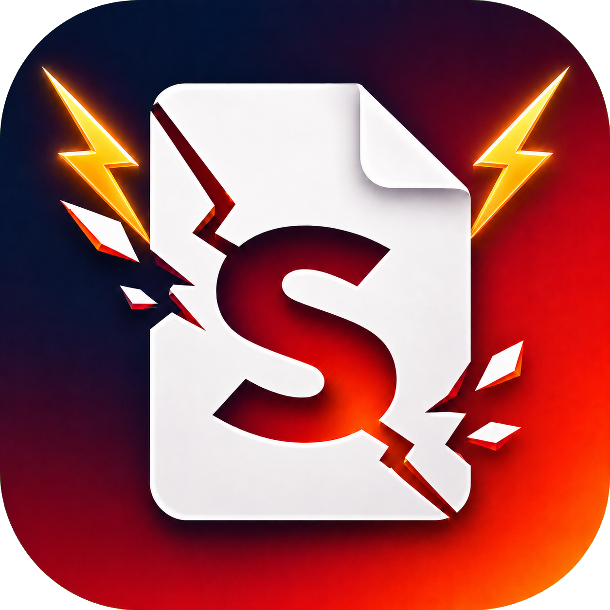

# SmashPDF

<p align="center">
  
</p>

A local-first Windows tool that unlocks, compresses, or AES-256 encrypts PDF
copies without changing the source files. Documents and passwords stay on your
computer.

## Download and run

Download `SmashPDF.exe` from the
[latest release](https://github.com/dklicious/SmashPDF/releases/latest), then
double-click it. No installation, Python runtime, account, or internet
connection is required.

Each release also includes a SHA-256 checksum and CycloneDX software bill of
materials (SBOM). Tagged release executables must pass Authenticode signing
and GitHub build-provenance attestation before publication.

Choose **Unlock PDF** or **Lock PDF**, then drag one or more PDFs into the drop box. You
can also click the box to browse. Each result is saved beside its source.
Use the language selector to switch the interface instantly between English,
Simplified Chinese, Traditional Chinese, Spanish, Japanese, and Korean.
The first launch starts in English; later launches restore the last selected
language.

Processing options:

- **Lock PDF** applies AES-256 encryption with an opening password and disables
  editing, copying, annotation changes, form filling, printing, and document
  assembly in compliant PDF readers.
- **Unlock only** keeps the original image quality.
- Tick **Compress PDF after unlocking** to enable it.
- **Standard compression** usually makes suitable PDFs 5-30% smaller.
- **Maximum compression** usually makes suitable PDFs 10-40% smaller.
- **Massive compression** targets 60%+ reduction on image-heavy or scanned PDFs.

Standard and Maximum compression are lossless: they do not resize or recompress
images, rasterise pages, remove text, or alter page geometry. Massive compression
downsamples and recompresses large embedded images, so image quality may be
reduced while text and page structure remain intact. A 60% reduction cannot be
guaranteed for text-only or already-optimised PDFs. The app shows the exact
saving after processing.

Example:

`Contract.pdf` becomes `Contract_unlocked.pdf`,
`Contract_unlocked_compressed.pdf`, or
`Contract_unlocked_major_compressed.pdf`, or
`Contract_unlocked_massive_compressed.pdf`, or `Contract_locked.pdf`.

If that name already exists, the tool creates `Contract_unlocked (2).pdf`.

## What it handles

- PDFs that open normally but have printing, copying, or editing restrictions.
- PDFs that require an opening password, when you provide that password.
- Digital-signature and certification locks.
- Multiple PDFs in one batch.
- Existing non-signature form fields.
- AES-256 password protection with restrictive PDF permissions.

Visible digital-signature appearances are retained as stamp annotations.
Cryptographic signature verification cannot remain valid after a PDF is
unlocked, so keep the original signed PDF as the authoritative copy.

## Standalone executable

`SmashPDF.exe` is self-contained. It does not require Python, Codex, an
internet connection, or installation.

## Build and test from source

Requires Python 3.11 or newer.

```powershell
python -m venv .venv
.\.venv\Scripts\python.exe -m pip install --require-hashes -r requirements-dev.lock
.\.venv\Scripts\python.exe -m ruff check .
.\.venv\Scripts\python.exe -m ruff format --check .
.\.venv\Scripts\python.exe -X dev -m coverage run -m pytest -W error
.\.venv\Scripts\python.exe -m coverage report
.\.venv\Scripts\python.exe -m bandit -q -r smashpdf.py
.\.venv\Scripts\python.exe -m pip_audit -r requirements-dev.lock
.\build.ps1
```

`requirements.lock`, `requirements-build.lock`, and `requirements-dev.lock`
pin the complete dependency graphs and hashes used by the app, release build,
and CI respectively.

Tagged GitHub releases additionally require two repository secrets:
`WINDOWS_CERTIFICATE`, containing a base64-encoded trusted code-signing PFX,
and `WINDOWS_CERTIFICATE_PASSWORD`. The release workflow imports the
certificate only on the temporary GitHub runner, signs and timestamps the EXE,
verifies the signature, and then removes the imported certificate.

## Command line

```powershell
python smashpdf.py "C:\path\document.pdf"
python smashpdf.py "C:\path\protected.pdf" --password "opening-password"
python smashpdf.py "C:\path\document.pdf" --output "C:\path\copy.pdf"
python smashpdf.py "C:\path\document.pdf" --compression standard
python smashpdf.py "C:\path\document.pdf" --compression major
python smashpdf.py "C:\path\document.pdf" --compression massive
python smashpdf.py "C:\path\document.pdf" --lock
```

When `--lock` is used, SmashPDF prompts for the new password without displaying
it. `--lock-password` is available for automation, but command-line arguments
may be visible to other local processes and should be avoided on shared systems.

Use `python smashpdf.py --help` for all options.

## Safety

- Processing is local; files and passwords are not uploaded.
- The source file is never overwritten.
- Output is written atomically and validated before delivery.
- Concurrent SmashPDF instances cannot replace one another's new outputs.
- A page-count check runs after every conversion.
- This tool does not bypass an unknown opening password.
- Lock mode uses a securely generated owner password that is never saved and
  verifies the AES-256 encryption and permission flags before publishing output.

PDF permission flags are enforced by compliant readers, but they are not
irreversible DRM. Someone who knows the opening password and uses specialised
software may be able to remove the restrictions. Keep sensitive source material
under appropriate access control as well.

To verify a downloaded release:

```powershell
Get-FileHash -Algorithm SHA256 .\SmashPDF.exe
Get-AuthenticodeSignature .\SmashPDF.exe
gh attestation verify .\SmashPDF.exe --repo dklicious/SmashPDF
```

See [SECURITY.md](SECURITY.md) for vulnerability reporting and the security
model.

## About

SmashPDF is made by **dklicious**. Thank you for your support.

## Licence

[MIT](LICENSE)
